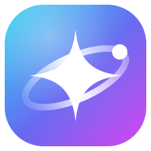
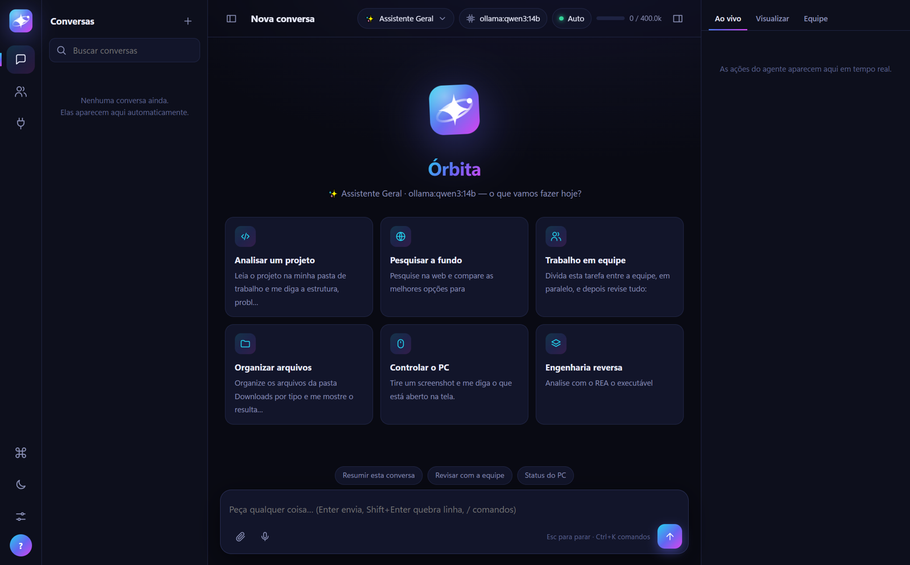
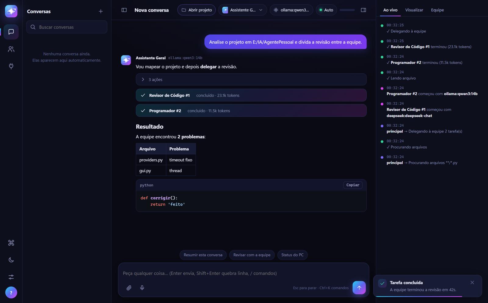
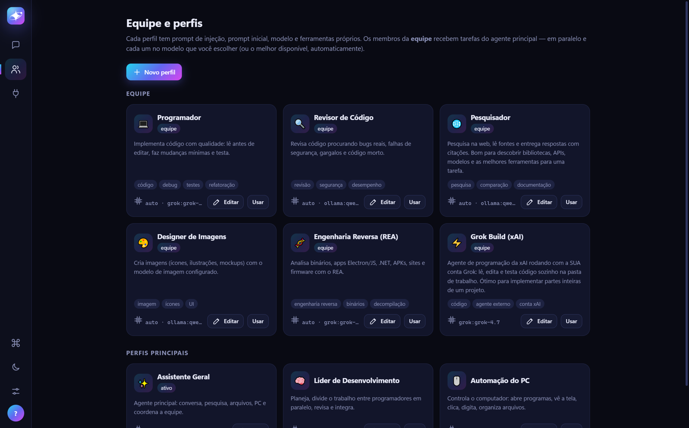
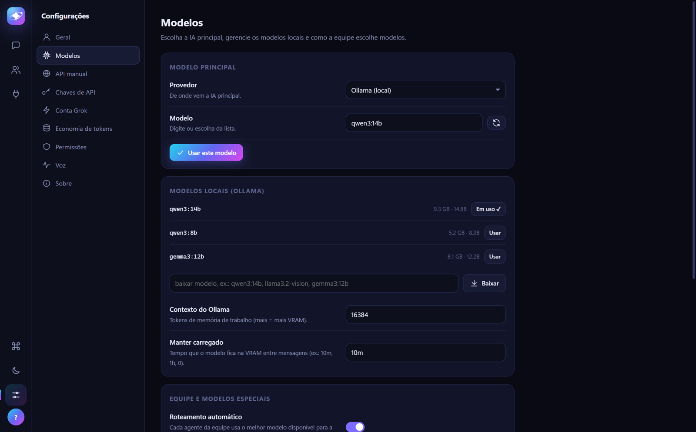

# Órbita

<p align="center">
  
</p>

<p align="center">
  <strong>Seu agente pessoal de IA, no seu computador.</strong><br>
  Conversa, programa, pesquisa, mexe em arquivos e programas e coordena uma equipe de agentes.<br>
  Conecta em qualquer software via MCP. O modelo é o que você escolher: local no Ollama,<br>
  ou na nuvem (DeepSeek, GPT, Claude, Gemini, Grok, OpenRouter e outras APIs).
</p>

<p align="center">
  <a href="LICENSE">GPL-3.0</a> · Windows e Linux · Python 3.10+ · só código-fonte
</p>

<p align="center">
  
</p>

## Começar

1. Instale o [Python 3.10, 3.11 ou 3.12](https://www.python.org/downloads/) e marque **Add python.exe to PATH**.
2. Na primeira vez, dê dois cliques em **`Iniciar_Orbita.bat`**. Ele cria o ambiente, instala as dependências, coloca o atalho **Órbita** na Área de Trabalho e no Menu Iniciar e abre a janela maximizada.
3. O assistente pergunta seu nome, qual IA usar (local, nuvem ou conta Grok), a pasta de trabalho e o nível de liberdade.
4. Depois disso, abra pelo atalho **Órbita**. Modelos, chaves, conta Grok, economia e voz ficam em **Configurações** (ícone de controles, ou Ctrl+,).

Para quem vai clonar:

```bat
git clone https://github.com/rafaelkennedyrkp20-bot/orbita.git
cd orbita
Iniciar_Orbita.bat
```

Verificar a instalação: `Verificar_Orbita.bat` · Modo terminal: `venv\Scripts\python agent\main.py --text` · Recriar atalhos: `py -3.10 launcher.py --shortcut`

O repositório é só o código. Modelos, o ambiente Python (`venv`), chaves, conversas e memória **não vêm junto** — o iniciador prepara o que falta na primeira abertura, e o que é seu fica neste computador.

### Linux

```bash
# Debian/Ubuntu (Fedora: sudo dnf install python3 git portaudio · Arch: sudo pacman -S python git portaudio)
sudo apt install python3 python3-venv git libportaudio2 xdg-utils
git clone https://github.com/rafaelkennedyrkp20-bot/orbita.git
cd orbita
./iniciar_orbita.sh
```

Na primeira vez, o script cria o ambiente, instala as dependências e coloca **Órbita** no menu de aplicativos.
Depois, abra o programa por lá. Verificar a instalação: `./iniciar_orbita.sh --check` · modo terminal:
`venv/bin/python agent/main.py --text`.

No Linux, a ferramenta de terminal do agente usa **bash** em vez do PowerShell, e os programas são abertos pelo menu
de aplicativos (arquivos `.desktop`) ou pelo `xdg-open`. O volume é controlado pelo `pactl` (PipeWire/PulseAudio) ou
pelo `amixer`. Mouse, teclado e captura de tela precisam de uma sessão gráfica X11 ou XWayland. Em Wayland puro,
essas três ferramentas avisam que não estão disponíveis, e o resto funciona normalmente. A voz em pt-BR que lê as
respostas precisa do Kokoro (`python setup_voz.py`); sem ele, é usado o `espeak` do sistema, se estiver instalado.

## A interface

- **Projeto**: clique em **Abrir projeto** (topo ou tela inicial) para abrir uma pasta ou criar uma nova — o agente
  lê, cria e edita arquivos dentro dela. Os projetos recentes ficam a um clique.
- **Conversas** salvas na lateral (busca, agrupadas por dia, renomeáveis) — reabra qualquer uma e continue.
- **Chat** com respostas em tempo real, Markdown, código com botão Copiar, e os **passos do agente** (ferramentas)
  em blocos recolhíveis; subagentes aparecem como cartões com o modelo que estão usando.
- **Ao vivo**: linha do tempo das ações; **Visualizar**: imagens/arquivos que o agente mostrou; **Equipe**: quem está trabalhando.
- **Notificações** no canto da janela e do Windows (quando a janela não está em foco), pedidos de **permissão** claros.
- **Ctrl+K** paleta de comandos · **Ctrl+N** nova conversa · **Ctrl+B** painel ao vivo · **Esc** para · tema claro/escuro.
- **Equipe e perfis** e **Conexões (MCP + skills)** têm páginas próprias.

<p align="center">
  <br>
  <em>A equipe trabalha no chat: passos, modelo de cada agente e o resultado.</em>
</p>

<p align="center">
  <br>
  <em>Perfis prontos. Cada um pode usar um modelo diferente.</em>
</p>

<p align="center">
  <br>
  <em>Modelo local no Ollama, ou qualquer API. A chave fica só neste PC.</em>
</p>

## O que ele faz

| Recurso | Como usar |
|---|---|
| **Qualquer IA** | Ollama, DeepSeek, OpenAI, Claude, **Grok Build (conta xAI)**, Gemini, OpenRouter, Groq, xAI, Mistral, LM Studio ou qualquer API compatível com OpenAI (Configurações → Novo provedor). Modelos sem suporte a ferramentas funcionam pelo modo "ferramentas por prompt". |
| **Prompts de injeção (perfis)** | Cada perfil tem *prompt de sistema* (entra em toda conversa), *prompt inicial* (enviado sozinho ao abrir uma conversa), modelo padrão, pasta de trabalho e ferramentas liberadas. Botão ✎ ao lado do perfil. |
| **Perfil por modelo** | No editor de perfil, marque "Ativar este perfil quando eu escolher este modelo". |
| **Roteamento automático** | Cada agente da equipe sem modelo fixo usa o melhor modelo disponível para a especialidade dele (código, revisão, pesquisa, raciocínio, visão, imagem), pesando qualidade × custo conforme o modo de economia. Catálogo editável em `data/model_catalog.json`. |
| **Compactação inteligente** | Quando a conversa enche o contexto, os turnos antigos viram um resumo (feito no modelo econômico) em vez de serem descartados. |
| **Equipe de agentes** | Programador, Revisor, Pesquisador, Designer e Engenharia Reversa. Cada um pode usar **outro modelo/API** (duplo clique na equipe). O agente principal delega em paralelo e revisa o resultado. O perfil *Líder de Desenvolvimento* faz isso em projetos de código. |
| **Ferramentas** | Arquivos (ler/editar/procurar), PowerShell, internet, abrir programas, screenshot com visão, mouse/teclado, área de transferência, memória, skills, geração de imagens. |
| **MCP** | Conecte programas pelo padrão MCP em `data/mcp.json` (mesmo formato do Claude Desktop/Cursor). O botão ⇩ importa os que você já tem. **REA** (engenharia reversa) já vem ligado. |
| **Skills** | Lê skills `SKILL.md` de `skills/`, `plugins/*/skills`, `~/.claude/skills`, `~/.agents/skills` e `~/.codex/skills`. |
| **Economia de tokens** | Modo Economia máxima / Equilibrado / Livre, orçamento por tarefa e por dia (o agente **pausa e pergunta** antes de estourar), medidor de tokens no rodapé, modelo econômico para subagentes. |
| **Permissões** | *Perguntar* (confirma qualquer alteração), *Automático* (confirma só execução/controle do PC) ou *Livre*. |
| **Voz** | 🎙 ditado: clique no microfone (ou Ctrl+M), fale e o texto vai aparecendo no campo; clique de novo para terminar e revise antes de enviar. Com chave da Groq (grátis) ou OpenAI, transcreve na nuvem, rápido em qualquer PC; sem chave, roda neste PC com um modelo leve (placa NVIDIA e modelos maiores são opcionais, em Configurações › Voz). Conversa por voz com respostas lidas pela voz neural Kokoro: Ctrl+K › Conversa por voz. |

## Grok Build com a sua conta xAI

O agente de programação da xAI (o mesmo do Grok Build Desktop) roda com a **sua conta**, sem chave de API:
**⚙ Configurações → Conta Grok → Entrar** (abre o navegador). Depois escolha o provedor
**Grok Build (conta xAI)** ou deixe o agente principal delegar ao **⚡ Grok Build** da equipe. Ele usa as
próprias ferramentas na pasta de trabalho do perfil, e a conversa continua entre mensagens.
Cada turno do Grok Build tem um custo-base de cerca de 16 mil tokens (o prompt dele é grande); o custo aparece no rodapé.

## Ferramentas de criação (imagem, 3D, jogos, vídeo)

Na página **Conexões**, a seção *Ferramentas de criação* oferece programas que a IA sabe usar. **Nada vem instalado**:
você baixa só o que quiser, ou o agente pede permissão mostrando nome, tamanho e origem.

| Programa | Para quê | Tamanho |
|---|---|---|
| ImageMagick | editar imagens: redimensionar, recortar, converter, sprites | ~12 MB |
| OpenSCAD | 3D por código: peças, objetos para impressão 3D (STL + prévia) | ~22 MB |
| Godot | jogos 2D/3D, validados pela linha de comando | ~86 MB |
| FFmpeg | vídeo e áudio: cortar, juntar, converter, GIF | ~35 MB |
| Blender | 3D completo sem janela: cenas, materiais, render, GLB/FBX | ~400 MB |

Cada programa tem versão fixa, vem do site ou GitHub oficial e só é instalado se o SHA-256 conferir. Fica em
`models\tools\` (fora do git) e pode ser removido pela mesma tela. Junto vêm as skills `editar-imagem`, `modelagem-3d`,
`jogos-godot`, `jogos-web` (jogos no navegador, sem instalar nada) e `video-ffmpeg`. No Linux, quando não houver pacote
portátil, a tela mostra o comando do gerenciador de pacotes.

## Conectando programas (MCP)

Edite `data/mcp.json` (botão `{ }`) e adicione servidores:

```json
{
  "mcpServers": {
    "rea": {"command": "npx", "args": ["-y", "rea-agents@6.5.0", "mcp"], "tools_mode": "deferred"},
    "playwright": {"command": "npx", "args": ["-y", "@playwright/mcp@latest"], "enabled": true},
    "remoto": {"url": "https://exemplo.com/mcp", "headers": {"Authorization": "Bearer ..."}}
  }
}
```

Campos extras: `enabled`, `tools_mode` (`direct`/`deferred`/`auto`), `always_load` (kit inicial de um
servidor adiado), `inherit_env` (variáveis do `.env` repassadas, ex.: `GHIDRA_INSTALL_DIR`), `risk`.
Plugins: crie `plugins/<nome>/` com `skills/` e/ou `.mcp.json`.

### REA — engenharia reversa
Já conectado (207 ferramentas, carregadas sob demanda). Formatos, arquitetura, apps Electron/JS e
sites funcionam direto. Para **decompilar binários nativos** o REA precisa de um motor de análise:
instale o [Ghidra 12.1](https://github.com/NationalSecurityAgency/ghidra/releases) e defina
`GHIDRA_INSTALL_DIR` no `.env` (ou rode `npx rea-agents setup`). Diagnóstico: `npx rea-agents@6.5.0 doctor`.

## Modelos locais

`huihui_ai/qwen2.5-abliterate:14b` é rápido, mas se perde em tarefas longas. Nos testes, o
**Qwen3.8 27B** já instalado (`hf.co/JonathanColetti/Qwen3.8-27B-Uncensored-GGUF:IQ4_XS`) delegou para a
equipe, verificou e respondeu corretamente — use-o (ou uma API na nuvem) para trabalho agêntico sério.
Ajuste `Contexto do Ollama` em Configurações conforme a VRAM.

## Para quem vai evoluir o projeto

Leia [AGENTS.md](AGENTS.md), [ROADMAP.md](ROADMAP.md) (guia de tarefas com o que falta) e
[ARCHITECTURE.md](ARCHITECTURE.md). Para pedir melhorias a qualquer IA, use o prompt pronto em
[docs/PROMPT_EVOLUCAO.md](docs/PROMPT_EVOLUCAO.md). Testes: `venv\Scripts\python.exe -m pytest tests -q`.

**Versão atual: 0.1.0-alpha.** O que mudou em cada versão está no [CHANGELOG.md](CHANGELOG.md). Correções
pequenas entram no GitHub sem mudar a versão; só atualizações grandes ganham número novo.

*100% seu: histórico, memória, chaves e perfis ficam neste computador.*

## Atualizar

**Pelo próprio programa:** ao abrir, o Órbita consulta este repositório (no máximo a cada 6 horas) e avisa quando há
melhorias. Em **Ver novidades** aparecem as mudanças e exatamente o que acontece com os arquivos. **Atualizar agora**
fecha o programa, atualiza e abre de novo sozinho:

- cópia feita com `git clone`: atualiza com `git pull --ff-only`. Se houver alterações suas não salvas, ou commits que
  não estão no GitHub, ele não mexe em nada e explica o motivo;
- código baixado em ZIP: troca só os arquivos do programa. Antes, guarda uma cópia de tudo que substitui ou remove em
  `data\updates\backup-…`. Arquivos que você criou nunca são apagados.

Nunca são tocados: conversas, configurações, perfis, chaves (`.env`), memória, `models\` e `venv\`. Se o
`requirements.txt` mudou, o launcher instala a diferença sozinho ao reabrir. A verificação pode ser desligada em
Configurações › Sobre. Quem baixou a 0.1.0-alpha antes desse recurso existir precisa atualizar uma vez à mão.

**À mão:** quem clonou faz `git pull` e abre de novo.

Para publicar uma versão nova a partir desta pasta: commit na branch `main` e `git push`. O remoto `origin` já aponta para este repositório. Não entre `venv\`, `models\`, `data\` nem `.env` — o `.gitignore` deixa isso de fora. Nenhuma versão compilada é publicada: quem usa, roda o código-fonte.

## Licença

O Órbita é software livre, licenciado sob a **GNU GPL v3** — veja [LICENSE](LICENSE).

Em palavras simples: qualquer pessoa pode usar, estudar, modificar e compartilhar o Órbita. Quem **distribuir**
uma versão modificada precisa publicar o código-fonte dessas mudanças sob a mesma licença. Assim ninguém pode
transformar o projeto em um programa fechado — as melhorias sempre voltam abertas para a comunidade.

Contribuições são bem-vindas: leia [AGENTS.md](AGENTS.md) e [ROADMAP.md](ROADMAP.md), rode os testes
(`venv\Scripts\python.exe -m pytest tests -q`) e abra um pull request.

Copyright (C) 2026 Os autores do Órbita.
